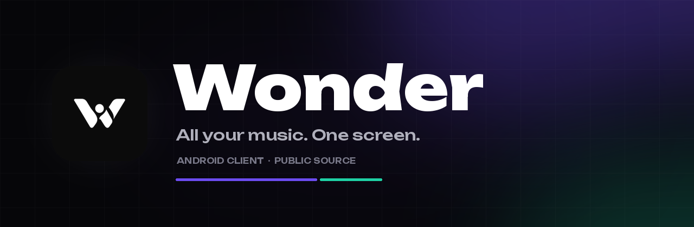
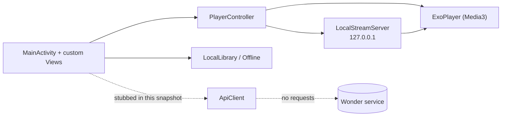

<div align="center">
  
</div>

<div align="center">

**Your music should feel like one place, not five apps.**

Source snapshot of the Android client: interface, player, library, offline mode.

[What is this repository](#what-is-this-repository) · [Build](#build) · [Permissions](#permissions) · [Security](#security-posture) · [Security policy](SECURITY.md)

<br>


</div>

---

## What is this repository

This is the **client side of Wonder**, published so the code can be inspected:
what the app does, what it stores, and what it sends over the network.

The production build of Wonder connects to a private service. That service — its
addresses, keys, recommendation engine, account system and the VK/SoundCloud/
Spotify/Yandex integrations — is **intentionally not part of this repository**.

In this snapshot the network layer is replaced with stubs. The app **builds,
installs and launches**, demonstrates the UI and the local player, and sends
nothing. Server-backed screens (Home, Search, Shorts, My Wave) show an empty
state.

> This is a source snapshot for review, not the full production codebase.
> The production APK is built from a private branch that includes the service
> integration.

## What is inside

| Area | What you get | Status |
|---|---|---|
| Playback | ExoPlayer/Media3, background service, media session, queue, next-track prefetch | Included |
| Sound | 10-band equalizer, bass, reverb, distortion, tempo/pitch, crossfade | Included |
| Audio FX | 10-band EQ, presets, bass shelf, reverb, distortion, tempo/pitch, crossfade | Included |
| Appearance | Accent color, wallpaper/GIF/video background, blur/dim, custom fonts | Included |
| Library | Tracks, artists, playlists, local collections, likes | Included |
| Offline | Download cache, eviction policy, local HTTP stream server | Included |
| Interface | Custom views, liquid navigation, player sheet, shorts feed, typography | Included |
| Design system | Dark monochrome palette, Unbounded typeface, 93 drawables, 9 layouts | Included |
| Service API | `ApiClient` contract with all public methods | Stubbed |
| Accounts | VK / SoundCloud / Spotify / Yandex / Google login and token exchange | Not included |
| Recommendations | Home feed, wave, similar tracks, remixes | Not included |
| Updates | In-app update banner UI | Stubbed |

**59 Kotlin/Java files · ~24k lines · 121 resource files.**

## Architecture



The player is local-first: audio is downloaded in segments, written to the app
cache, and served to ExoPlayer through a loopback HTTP server. That is why
`INTERNET` is still declared — the loopback server needs it even when the phone
is offline.

## Module map

| Path | Responsibility |
|---|---|
| `app/src/main/java/su/gwarden/music/MainActivity.java` | Shell, navigation, tabs, settings, player binding |
| `.../player/PlayerController.kt` | Playback state machine, cache, retries, prefetch |
| `.../player/PlaybackService.kt` | Foreground media service and notification |
| `.../player/LocalStreamServer.kt` | Loopback HTTP server for growing cache files |
| `.../player/ParallelDownloader.kt` | Segmented downloader |
| `.../audio/` | DSP chain: 10-band EQ, bass, reverb, distortion |
| `.../ui/Skin.kt`, `.../AppearanceActivity.kt` | Accent, wallpaper, blur/dim, fonts |
| `.../ui/` | Custom views: liquid nav, equalizer background, artwork tint, adapters |
| `.../model/` | Track, playlist, library, profile and interest models |
| `.../offline/Offline.kt` | "Keep on device" downloads and storage limit |
| `.../api/ApiClient.kt` | Public API contract; stubbed in this snapshot |
| `.../vk/`, `.../spotify/` | Integration boundaries; disabled in this snapshot |
| `.../update/` | In-app update UI; network stubbed in this snapshot |
| `app/src/main/res/` | Themes, drawables, layouts, Unbounded font, icons |

## Build

Requirements: **JDK 17** and **Android SDK platform 35**.

```bash
git clone https://github.com/sntroop/Wonder.git
cd Wonder/android
echo "sdk.dir=$ANDROID_HOME" > local.properties
./gradlew assembleDebug
# -> app/build/outputs/apk/debug/app-debug.apk
```

Release build:

```bash
./gradlew assembleRelease
# -> app/build/outputs/apk/release/app-release-unsigned.apk
```

The release APK is unsigned by design: sign it with your own key
(`apksigner` or Android Studio).

| Tool | Version |
|---|---|
| Android Gradle Plugin | 8.7.3 |
| Kotlin | 2.0.21 |
| Gradle | 8.14 |
| compileSdk / targetSdk | 35 |
| minSdk | 24 (Android 7.0) |
| Java | 17 |

## Permissions

| Permission | Why it is needed |
|---|---|
| `INTERNET` | Loopback HTTP server for playback, plus media/artwork loading |
| `ACCESS_NETWORK_STATE` | Avoid endless spinners when the device is offline |
| `POST_NOTIFICATIONS` | Player notification with artwork and controls |
| `FOREGROUND_SERVICE` | Music keeps playing in the background |
| `FOREGROUND_SERVICE_MEDIA_PLAYBACK` | Media playback foreground service type |
| `WAKE_LOCK` | Audio does not stall when the screen turns off |

Wonder does **not** request contacts, camera, location, SMS, microphone or
external storage access. Cleartext traffic is allowed only for
`127.0.0.1`/`localhost` — see
[`network_security_config.xml`](android/app/src/main/res/xml/network_security_config.xml).

## Security posture

- No dynamic code loading: no downloaded dex/apk/so, no reflection loaders.
- No cookies, account tokens or service credentials are exchanged.
- No telemetry, analytics or remote logging.
- No hidden endpoints or hardcoded server addresses.
- The only HTTP server is the loopback player server.
- Crash logs stay on the device and are copied to the clipboard only when the
  user enables debug mode.

See [SECURITY.md](SECURITY.md) for the full audit checklist and verification
commands.

## Limitations of this snapshot

- Account login and service linking are disabled.
- Home, Search, Shorts and My Wave have no data source; they render empty states.
- `ApiClient`, `vk/*` and `spotify/*` are compile-time stubs.
- The production APK is not built from this repository; it lives in a private
  branch with the service integration.

## Project structure

```text
Wonder/
├── README.md
├── SECURITY.md
├── docs/
│   └── banner.png
└── android/
    ├── build.gradle.kts
    ├── settings.gradle.kts
    ├── gradle/wrapper/
    └── app/
        ├── build.gradle.kts
        └── src/main/
            ├── AndroidManifest.xml
            ├── java/su/gwarden/music/
            │   ├── MainActivity.java
            │   ├── api/
            │   ├── model/
            │   ├── offline/
            │   ├── player/
            │   ├── spotify/
            │   ├── ui/
            │   └── vk/
            └── res/
                ├── drawable*/
                ├── font/
                ├── layout/
                ├── mipmap-*/
                ├── values/
                └── xml/
```

## Tech stack

| Layer | Choice |
|---|---|
| Language | Kotlin 2.0.21 + Java 17 |
| UI | Android Views, Material Components, custom drawing |
| Playback | AndroidX Media3 / ExoPlayer 1.4.1 |
| HTTP | OkHttp 4.12 |
| JSON | Gson 2.11 |
| Images | Glide 4.16 |
| Async | Kotlin Coroutines 1.8.1 |
| Typography | Unbounded (variable, OFL) |

## FAQ

**Is this the full Wonder app?**
No. It is the client source without the private service. The production build
adds the backend integration, accounts and recommendations.

**Does the app phone home?**
Not in this snapshot. The network layer is stubbed and there is no telemetry.
The only local HTTP server is used to feed cached audio to ExoPlayer.

**Why are some screens empty?**
Because they need the private service. The UI, player and offline layer work
without it.

**Can I plug in my own backend?**
Yes. `ApiClient` is a clean contract; implement it and the UI can consume your
data. The stubs show the expected shapes.

**Why is the package `su.gwarden.music`?**
It is the historical package id. Changing it would break installs and updates,
so it stays.

## Credits

Wonder uses the open-source AndroidX, Material Components, Media3/ExoPlayer,
OkHttp, Gson, Glide and Kotlin Coroutines libraries. The Unbounded typeface is
licensed under the SIL Open Font License.

## License

Source available for inspection and study. All rights to the Wonder name, code
and visual assets belong to the author. Reuse in other products requires
permission.

<div align="center">
<br>
<sub>Built with care. No trackers. No telemetry. No backend in this repository.</sub>
</div>
